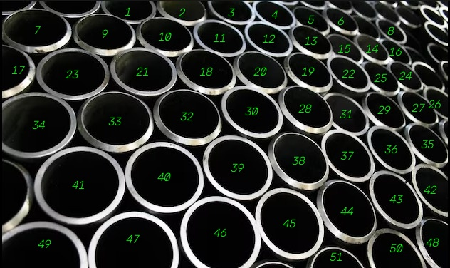
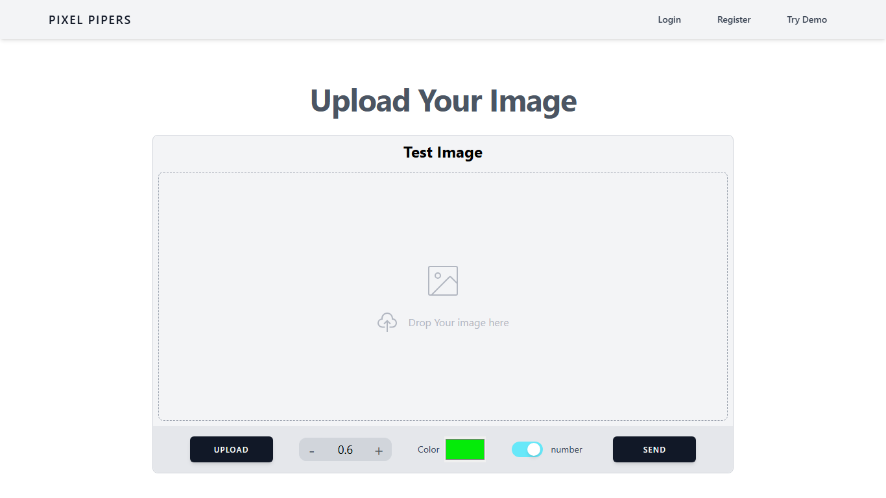
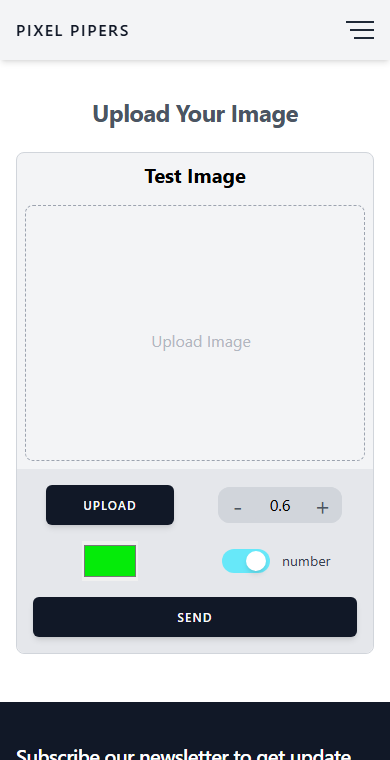

# Pixel Pipers

**Count pipes in a photo automatically.** Upload a picture of a pipe bundle. A trained YOLO model
finds every pipe end and returns the total count, with a dot or a number drawn on each pipe.

Counting a stack of hundreds of pipes by hand is slow and error-prone in factories, warehouses and
on trucks. Pixel Pipers does it in seconds from a single photo.

<p align="center">
  
  
  
  <br>
  <em>Input photo → result with numbers → result with dots (51 pipes detected)</em>
</p>

## 🌐 Live demo

| | Link |
|---|---|
| **Website** | **https://pixel-pipers-sepia.vercel.app** |
| Backend API | https://pixel-pipers.onrender.com |
| API documentation | https://pixel-pipers.onrender.com/api-doc |

> ⏳ The backend runs on a free server that **sleeps after 15 minutes without visitors**.
> The first image after that can take **1–3 minutes** while it wakes up; later images are faster.

---

## Contents

1. [Using the website](#1-using-the-website)
2. [How it works](#2-how-it-works)
3. [Tech stack](#3-tech-stack)
4. [Project structure](#4-project-structure)
5. [Run it on your own computer](#5-run-it-on-your-own-computer)
6. [Use the API in your own app](#6-use-the-api-in-your-own-app)
7. [Deploy your own copy](#7-deploy-your-own-copy)
8. [Configuration](#8-configuration)
9. [Troubleshooting](#9-troubleshooting)
10. [Limitations and future work](#10-limitations-and-future-work)

---

## 1. Using the website

<p align="center">
  
  
</p>

The site works on desktop, tablet and phone.

1. Open **https://pixel-pipers-sepia.vercel.app**.
2. Click **Upload** and choose a photo of pipe ends. On a computer you can also drag the photo into the box.
3. Adjust the options if you want:

   | Control | What it does |
   |---|---|
   | **− 0.6 +** (confidence threshold) | How sure the model must be before it counts something as a pipe. **Lower** (e.g. 0.4) finds more pipes but may count wrong things; **higher** (e.g. 0.8) counts only very clear pipes. **0.5–0.6 works best.** |
   | **Color** | Colour of the dots or numbers drawn on the result image. |
   | **dot / number** toggle | Draw a **dot** on each pipe, or a **number** (1, 2, 3 … from top to bottom) so you can check the count by eye. |

4. Click **Send** and wait for the spinner.
5. The **Result Image** shows the marked photo, the **No of Object** (pipe count) and the threshold used.

**Tips for accurate counts:**
- Take the photo **straight on**, facing the pipe ends.
- Use good light, with no strong glare.
- Fit the whole bundle in the frame.
- Pipes cut off at the edge of the photo may not be counted.

---

## 2. How it works

### Big picture

```
 ┌──────────────── Browser ────────────────┐          ┌──────────────── Backend (Flask) ─────────────────┐
 │  React website (Vercel)                 │          │  Docker container (Render)                        │
 │                                         │  HTTPS   │                                                   │
 │  1. user picks a photo                  │  POST    │  3. check the Bearer token                        │
 │  2. resize to ≤ 800×600, JPEG 70 %  ────┼─────────►│  4. save photo with a random name                 │
 │     + threshold, colour, dot/number     │/frontend │  5. YOLO model (best.pt) finds every pipe         │
 │                                         │          │  6. OpenCV draws a dot / number on each pipe      │
 │  8. show count + marked image  ◄────────┼──────────┤  7. reply { count, image_url }, delete temp files │
 └─────────────────────────────────────────┘   JSON   └───────────────────────────────────────────────────┘
```

### Step by step

**In the browser (`Frontend/src/pages/Demo.tsx`)**
1. The chosen photo is read with `FileReader` and shown as a preview.
2. When you press **Send**, the photo is drawn onto a hidden `<canvas>`, scaled down to at most
   800×600 and saved as a 70 % quality JPEG. This keeps the upload under 500 KB, so it's fast even on mobile data.
3. `sendImageToServer` (`src/app/actions/fileAction.ts`) sends a `multipart/form-data` request to
   `POST /frontend` with the image, threshold, colour and dot/number choice, plus the header
   `Authorization: Bearer <token>`.
4. Redux (`src/app/slices/fileSlice.ts`) tracks the request. While it runs, a spinner is shown.
   When the reply arrives, the result card appears and the page scrolls to it.

**On the server (`Backend/PIPE_model/app.py`)**

5. The `authenticate` decorator rejects the request with **401** unless the token matches `API_TOKEN`.
6. The image is saved as `<uuid>.jpg`. The random name means two users never overwrite each other.
7. `model.predict()` runs the **YOLO** object-detection model `best.pt`, which was trained on pipe-end images.
   With `save_txt=True`, YOLO writes one line per detected pipe:

   ```
   class  x_center  y_center  width     height     ← all values 0–1, relative to image size
   0      0.177160  0.688606  0.201960  0.290721
   ```

8. `draw_on_image.py` reads those lines, converts the 0–1 values into pixel positions, and uses OpenCV to draw
   a **dot** at each centre, or a **number** sorted top-to-bottom.
9. The marked image is returned as an inline `data:image/jpeg;base64,...` URL, or as a Cloudinary URL
   if Cloudinary is configured. Then all temporary files are deleted.

### What is YOLO?

**YOLO ("You Only Look Once")** is a fast object-detection neural network. It looks at the whole image
once and outputs a box plus a confidence score for every object it recognises. Here it was trained to
recognise **pipe ends**, so the number of boxes is the number of pipes. The **confidence threshold** you set on the
website is the minimum score a box needs to be counted.

Earlier model versions are kept in `Backend/PIPE_model/old_models/` for reference. The app uses `best.pt`.

---

## 3. Tech stack

| Part | Technologies |
|---|---|
| **Frontend** | React 18, TypeScript, Vite, Tailwind CSS, Redux Toolkit, React Router, Axios, react-toastify |
| **Backend** | Python 3.12, Flask, Flask-CORS, Gunicorn |
| **AI / image processing** | Ultralytics YOLO (8.3), PyTorch (CPU), OpenCV |
| **Hosting** | Vercel (frontend), Render (backend, Docker), GitHub (code) |

---

## 4. Project structure

```
Pixel_pipers/
├── Frontend/                     React website
│   ├── .env.example              copy to .env – backend URL + token
│   ├── vercel.json               lets page refreshes work on Vercel
│   └── src/
│       ├── main.tsx              entry point (Redux + router + toasts)
│       ├── App.tsx               routes: /, /demo, /login, /register, /payment, 404
│       ├── pages/Demo.tsx        ★ upload → compress → send → show result
│       ├── container/layout/     Header (responsive navbar), Footer
│       ├── components/           buttons, Counter (threshold), ResultCard,
│       │                         ImageAnnotation, Loader, Toast, form inputs
│       ├── app/                  Redux store, slices (state), actions (API calls)
│       └── lib/                  types, validators, navbar links, form fields
│
├── Backend/                      Flask API + YOLO model
│   ├── Dockerfile                image used by Render (Python 3.12, CPU PyTorch, gunicorn)
│   ├── .dockerignore             keeps secrets / old models out of the image
│   └── PIPE_model/
│       ├── app.py                ★ all API routes, explained with comments
│       ├── draw_on_image.py      draws dots / numbers with OpenCV
│       ├── best.pt               the trained YOLO model (22 MB)
│       ├── wsgi.py               gunicorn entry point
│       ├── requirements.txt      pinned Python packages
│       ├── credentials.example.json  copy to credentials.json for local use
│       ├── templates/ static/    the /api-doc documentation page
│       ├── collect-retrain/      images + labels saved by /retrain
│       ├── old_models/           earlier model versions (not used)
│       ├── web_cam.py            stand-alone: live detection from a webcam
│       ├── video_yolo.py         stand-alone: count pipes in a video
│       └── train_model.py        experimental training script (not used)
│
├── API-Docs/                     the API documentation as a stand-alone page
├── docs/screenshots/             images used in this README
├── DEPLOYMENT.md                 step-by-step guide to put it online
└── README.md                     this file
```

Every source file starts with a comment explaining what it does.

---

## 5. Run it on your own computer

### Requirements
- **Python 3.10+** (tested with 3.12): https://www.python.org/downloads/
- **Node.js 18+** (tested with 22): https://nodejs.org/
- **Git**: https://git-scm.com/
- About 3 GB of free disk space (PyTorch is large)

### 1. Get the code

```bash
git clone https://github.com/Pawanjangid4424/Pixel_pipers.git
cd Pixel_pipers
```

### 2. Set up the backend

```bash
cd Backend/PIPE_model
pip install -r requirements.txt          # Flask, YOLO, PyTorch … (takes a few minutes)
```

Create **`credentials.json`** by copying `credentials.example.json`, and choose your own values:

```json
{
  "username": "admin",
  "password": "change-me",
  "token": "sk_make_up_any_long_random_text"
}
```

Start it:

```bash
python app.py
```

Wait for `Running on http://127.0.0.1:5001`. Open http://localhost:5001/api-doc to check that it works.

### 3. Set up the frontend (in a second terminal)

```bash
cd Frontend
npm install
```

Create **`Frontend/.env`** by copying `.env.example`. Use **the same token** as in `credentials.json`:

```env
VITE_SERVER_URL='http://localhost:5001'
VITE_ML_TOKEN='sk_make_up_any_long_random_text'
```

Start it:

```bash
npm run dev
```

Open **http://localhost:5174**. Keep both terminals running while you use the site.

> **Windows note:** if your folder path contains `&` (e.g. `Pawan & Bhanu`), `npm run dev` fails
> because cmd.exe treats `&` as a command separator. Rename the folder, or run
> `node node_modules/vite/bin/vite.js` instead.

### Optional: run the backend with Docker

If you have Docker Desktop, you don't need Python installed:

```bash
cd Backend
docker build -t pixel-pipers-backend .
docker run -p 7860:7860 -e API_TOKEN=sk_your_token -e API_USERNAME=admin -e API_PASSWORD=secret pixel-pipers-backend
```

Then set `VITE_SERVER_URL='http://localhost:7860'` in `Frontend/.env`.

### Optional: stand-alone scripts

```bash
cd Backend/PIPE_model
python web_cam.py                # live detection from your webcam (press q to quit)
python video_yolo.py video.mp4   # count pipes in a video; saves object_counting_output.avi
```

---

## 6. Use the API in your own app

Any program can send an image to the backend and get the count back.
Interactive docs: **https://pixel-pipers.onrender.com/api-doc**

Every request except `/login` and `/api-doc` needs the header:

```
Authorization: Bearer <API token>
```

The token for the public demo is not published. Run your own copy (section 5 or 7) to get a token,
or ask the repository owner.

### Endpoints

| Method | Route | Send | Get back |
|---|---|---|---|
| POST | `/frontend` | form-data: `uploadImage` (file), `confidence_threshold` (0.1–0.9, default 0.6), `key` (0 = dots, 1 = numbers), `color` (`#RRGGBB`), `font_scale` (default 0.5) | `{ "count": "51", "image_url": "data:image/jpeg;base64,…" }` |
| POST | `/images` | same as `/frontend` | `{ "count": "51", "image_base64": "…" }` |
| POST | `/coordinates` | form-data: `uploadImage`, `confidence_threshold` | `{ "count": "51", "coordinates": ["0 0.17 0.68 0.20 0.29", …] }` |
| POST | `/cloudinary` | JSON: `{ "image_path": "<image URL>", "confidence_threshold": 0.6 }` | `{ "count", "image_url" }` |
| POST | `/retrain` | form-data: `uploadImage` + `uploadTxt` (YOLO label file) | saves both in `collect-retrain/` for future training |
| POST | `/login` | JSON: `{ "username", "password" }` | `{ "token" }` |
| GET | `/api-doc` | – | HTML documentation |

Errors: **401** means the token is missing or wrong. `{"Error": "..."}` means no image was sent.

### Example: curl

```bash
curl -X POST https://pixel-pipers.onrender.com/frontend \
  -H "Authorization: Bearer sk_your_token" \
  -F "uploadImage=@pipes.jpg" \
  -F "confidence_threshold=0.6" \
  -F "key=1"
```

### Example: Python

```python
import base64, requests

API = "https://pixel-pipers.onrender.com"      # or http://localhost:5001
TOKEN = "sk_your_token"

with open("pipes.jpg", "rb") as f:
    r = requests.post(f"{API}/images",
                      headers={"Authorization": f"Bearer {TOKEN}"},
                      files={"uploadImage": f},
                      data={"confidence_threshold": 0.6, "key": 1, "color": "#00ff00"},
                      timeout=300)          # free server can be slow to wake up
r.raise_for_status()
result = r.json()
print("Pipes:", result["count"])
open("result.jpg", "wb").write(base64.b64decode(result["image_base64"]))
```

### Example: JavaScript (browser)

```js
const form = new FormData();
form.append('uploadImage', fileInput.files[0]);
form.append('confidence_threshold', '0.6');
form.append('key', '0');

const res = await fetch('https://pixel-pipers.onrender.com/frontend', {
  method: 'POST',
  headers: { Authorization: 'Bearer sk_your_token' },
  body: form,
});
const { count, image_url } = await res.json();
document.querySelector('img').src = image_url;   // works for both data: and https: URLs
```

---

## 7. Deploy your own copy

The full guide is in **[DEPLOYMENT.md](DEPLOYMENT.md)**. In short:

1. **Fork** this repository on GitHub.
2. **Backend on Render** (free): New → Web Service → your fork → Language **Docker**, Root Directory
   **`Backend`**, Instance **Free**. Add the environment variables `API_TOKEN`, `API_USERNAME`, `API_PASSWORD`.
3. **Frontend on Vercel** (free): Add New → Project → your fork → Root Directory **`Frontend`**.
   Add `VITE_SERVER_URL` (your Render URL) and `VITE_ML_TOKEN` (same value as `API_TOKEN`).
4. Every `git push` to `main` redeploys both automatically.

---

## 8. Configuration

| Setting | Where | Default |
|---|---|---|
| API token, username, password | env `API_TOKEN`, `API_USERNAME`, `API_PASSWORD`, or `Backend/PIPE_model/credentials.json` | – (required) |
| Backend port | env `PORT` | 5001 (`python app.py`), 7860 (Docker) |
| Gunicorn workers | env `WORKERS` (each worker uses ~440 MB RAM) | 1 |
| Request timeout | env `GUNICORN_TIMEOUT` (seconds) | 300 |
| Cloudinary image hosting (optional) | env `CLOUDINARY_CLOUD_NAME`, `CLOUDINARY_API_KEY`, `CLOUDINARY_API_SECRET` | off: images returned inline |
| Backend URL used by the website | `VITE_SERVER_URL` in `Frontend/.env` or Vercel | `http://localhost:5001` |
| Token used by the website | `VITE_ML_TOKEN` in `Frontend/.env` or Vercel | – (must equal `API_TOKEN`) |
| Frontend dev port | `Frontend/vite.config.ts` | 5174 |

> **Security note:** `VITE_*` values are built into the website's JavaScript, so anyone can find the token in
> their browser. The token stops casual misuse, but it is not a real password. Never reuse a real
> password as the token.

---

## 9. Troubleshooting

| Problem | Solution |
|---|---|
| Spinner runs for a long time | The free server is waking up. Wait 1–3 min, or open `/api-doc` first to wake it. |
| "Error uploading image" | Backend not running, or wrong `VITE_SERVER_URL`. It must have no `/` at the end. |
| **401** "Invalid or expired token" | `VITE_ML_TOKEN` (frontend) and `API_TOKEN` / `credentials.json` token (backend) differ. |
| "Image size exceeds 500kb" | Rarely happens after the automatic compression. Try a smaller photo. |
| Count too low | Lower the threshold (e.g. 0.4), and use a sharper, straight-on photo. |
| Count too high (wrong things counted) | Raise the threshold (e.g. 0.7). |
| `npm run dev` fails on Windows with `D:\vite\bin\vite.js` | Your folder path contains `&`. See the Windows note in section 5. |
| `No credentials found` when starting the backend | Create `credentials.json` or set `API_TOKEN` (section 5). |
| Changed `.env` but nothing happened | Restart `npm run dev`. On Vercel, redeploy. |

---

## 10. Limitations and future work

- **Speed on the free plan:** the free Render server has a small CPU, so each image takes about 1 minute.
  A paid plan or Azure for Students makes it much faster (see DEPLOYMENT.md).
- **Teaching the model with corrections:** the **Annotation tool** (button under the result) already lets you
  draw boxes around missed pipes, and the backend's `/retrain` endpoint already stores corrected examples.
  Connecting the tool's **Send** button to `/retrain`, and adding a retraining script, would let the model
  improve from its own mistakes.
- **Login / Register and Payment pages** are UI only. They need a separate user server and a Razorpay
  payment server, which are not part of this repository. Pipe counting works without them.

---

## License

MIT. See [`Frontend/LICENSE`](Frontend/LICENSE).
